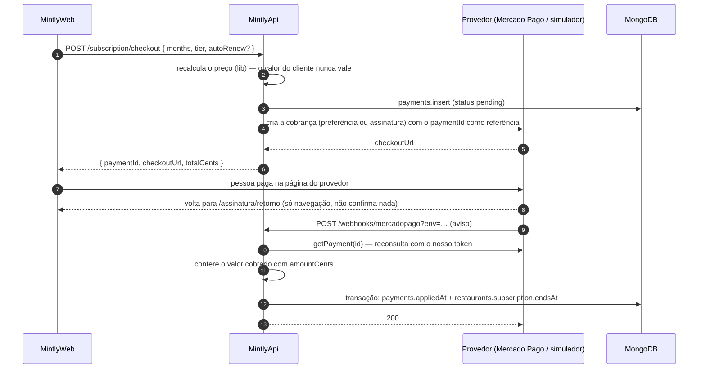

# 💳 MintlyApi — assinatura e pagamentos

O Mintly é pago: sem assinatura válida, as rotas do app respondem **402 `SUBSCRIPTION-0001`** e o front leva à tela de assinatura. Este documento cobre planos, cobrança (Mercado Pago ou simulador), confirmação por webhook, renovação automática, estorno e as ferramentas administrativas.

Código: `src/app/subscription/` (API) · `src/core/data/subscription/subscription.ts` (regras puras na [mintly-lib](../libs/mintly-lib.md)).
Dados: `restaurants.subscription` e `payments` — ver [Atributos das coleções](../base-de-dados/colecoes-atributos.md#payments).

---

## Planos e preços

Dois **tipos** e quatro **durações**. O preço é sempre calculado no servidor pela lib (`subscriptionPlanPrice`); o valor que o front mostra vem do mesmo cálculo.

| Tipo | Mensal | Funcionários ativos | IA |
|---|---|---|---|
| **Básico** (`basic`) | R$ 149,90 | 5 | não |
| **Pro** (`pro`) | R$ 229,90 | 20 | sim |

| Duração | Dias de acesso | Desconto |
|---|---|---|
| 1 mês | 30 | 0% |
| 3 meses | 90 | 5% |
| 6 meses | 180 | 10% |
| 12 meses | 360 | 15% |

- **Dias fixos, não meses de calendário:** 1 mês = 30 dias, sempre. Assim cada plano dura o mesmo em qualquer época do ano.
- Valores em **centavos inteiros** (`amountCents`); o desconto é arredondado ao centavo.
- O dono não conta no limite de funcionários; inativar alguém libera a vaga.

---

## O estado da assinatura

O único campo que o acesso exige é **`restaurants.subscription.endsAt`**. O estado é calculado na leitura (`computeSubscriptionState`), nunca gravado:

| Estado | Condição |
|---|---|
| `active` | agora < `endsAt` — `daysLeft` arredondado para cima; `expiresSoon` com 3 dias ou menos |
| `expired` | `endsAt` no passado (o tipo do último plano continua visível) |
| `none` | nunca teve `endsAt` |

**Onde é conferido:**
- **`requireActiveSubscription`** (preHandler das rotas do app) → 402 se não estiver `active`.
- **`requireProTier`** (rotas `/ai`) → 403 `AI-0003` se o tipo não for `pro`. Sem tipo gravado, conta como Básico.
- **Login e signup** devolvem o estado, para o front decidir a primeira tela.
- Rotas de assinatura, conta (`/users/me`) e pedido de exclusão ficam **fora do portão**: quem está vencido precisa conseguir assinar e mexer na própria conta.

> Liberar uma conta à mão (suporte): gravar `subscription.endsAt` no restaurante basta.

---

## Fluxo de compra

### Regras da confirmação (`ConfirmPaymentUseCase`)

- **O aviso nunca vale por si:** ele só diz "olhe o pagamento X". A API reconsulta o pagamento **no provedor** com o próprio token e só então decide. Valor diferente do cobrado → `amount_mismatch`, nada é liberado.
- **Uma vez só por pagamento:** `payments.appliedAt` marca que o pagamento já somou dias, e o índice único em `providerPaymentId` impede registrar a mesma cobrança duas vezes. Avisos repetidos ou simultâneos não somam de novo.
- **Como os dias são somados** (`applySubscriptionPurchase`):

| Situação | Novo `endsAt` |
|---|---|
| mesmo tipo e assinatura ainda ativa | soma os dias do plano ao que sobrou |
| tipo diferente (upgrade **ou** downgrade) | conta a partir de **hoje**; o que sobrava do tipo anterior é descartado, sem crédito |
| vencida ou nunca assinou | conta a partir de hoje |

- O pagamento guarda **`grantedMs`**, o tempo exato que acrescentou. Quando uma compra recomeça a contagem, os pagamentos anteriores ganham **`supersededAt`**: o tempo deles não existe mais na assinatura.
- **Rebaixamento de plano:** se o novo tipo tem menos vagas que os funcionários ativos, os excedentes (mais recentes primeiro) são inativados e têm as sessões revogadas (`member-limit-enforcement.ts`, evento `members_deactivated_by_plan`). Roda fora da transação, sem desfazer o pagamento.

### Estorno e chargeback

Um pagamento já aplicado que o provedor passa a reportar como estornado (`refunded` ou `charged_back` no Mercado Pago, ambos lidos como `refunded`) **desconta o mesmo `grantedMs`** de `endsAt`, uma vez só (`revokedAt`). Se a data cair no passado, a conta passa a receber 402 na hora. Pagamento com `supersededAt` não desconta nada (o tempo dele já não estava na assinatura). Estorno parcial não passa por aqui: o status do pagamento continua aprovado.

---

## Renovação automática

Com `autoRenew: true` no checkout, a API cria uma **assinatura no provedor** (preapproval do Mercado Pago, sem plano associado), que cobra o mesmo cartão a cada 30/90/180/360 dias.

- O **primeiro pagamento** acontece quando a pessoa autoriza no link. Cada cobrança aprovada entra pelo mesmo caminho do pagamento único (reconsulta + valor + uma vez só) e soma os dias do plano. Cobranças seguintes ganham um registro próprio em `payments` (`kind: recurring`).
- O estado da renovação fica em `restaurants.subscription.recurring` (`pending`, `authorized`, `paused`, `cancelled`), atualizado pelo aviso `subscription_preapproval`.
- **Trocar de plano** com uma renovação nova cancela a antiga no provedor.
- **`POST /subscription/cancel-renewal`** para de cobrar; o acesso vale até a data já paga.
- **Referência com o ambiente:** as cobranças da renovação chegam no webhook cadastrado no painel do Mercado Pago, **sem** o `?env=` da URL. Por isso a referência da assinatura leva o ambiente junto (`"staging|<paymentId>"`) e a API descobre o banco pelo que o próprio provedor devolve na reconsulta (`payment-reference.ts`).

---

## Provedores

O contrato `PaymentProvider` isola o resto do código do provedor. A escolha vem de `PAYMENT_PROVIDER` (`get-payment-provider.ts`):

| Provedor | Quando | Como funciona |
|---|---|---|
| `mercadopago` | produção e testes de integração real | **Checkout Pro**: cria uma "preferência" e leva a pessoa à página do Mercado Pago (cartão, Pix, boleto). `MP_SANDBOX=true` usa o link de teste |
| `mock` | desenvolvimento e staging sem cobrança real | a cobrança aponta para a tela `/assinatura/simulador` do próprio app; a pessoa aprova ou recusa (`POST /subscription/mock/decide`) e, a partir daí, o caminho é **o mesmo** do Mercado Pago. `POST /subscription/mock/charge-next` simula a próxima cobrança da renovação |

- **Falha fechada:** sem a variável, só o ambiente de desenvolvimento cai no `mock`. Em produção, e na Vercel (que força `NODE_ENV=production` até na staging), é obrigatório escolher, porque o simulador aprova sem cobrar.
- Com o provedor real, as rotas `/subscription/mock/*` respondem como se não existissem.
- Falha ao falar com o provedor → **502 `PAYMENT-0001`**; a pessoa pode tentar de novo.

### Webhook do Mercado Pago

`POST /webhooks/mercadopago?env=<ambiente>` — público (o provedor não manda JWT).

| Tópico | O que a API faz |
|---|---|
| `payment` | pagamento único ou cobrança: reconsulta e confirma |
| `subscription_authorized_payment` | cobrança da renovação: reconsulta cobrança, assinatura e pagamento; confere que a assinatura é a registrada |
| `subscription_preapproval` | assinatura autorizada, pausada ou cancelada: atualiza `subscription.recurring` |
| outros | ignorados (200) |

- **Assinatura do aviso:** com `MP_WEBHOOK_SECRET`, valida o header `x-signature` (`ts=…,v1=…`, HMAC-SHA256 de `id:<data.id>;request-id:<x-request-id>;ts:<ts>;`). Sem o segredo o aviso não é autenticado, mas isso **não concede nada**: o pagamento é sempre reconsultado.
- **Respostas:** 200 para avisos tratados ou ignorados (o provedor não reenvia à toa); falha ao consultar o provedor → 500, e o Mercado Pago tenta de novo.
- O endereço do aviso sai de `API_URL`. Se o deploy estiver sem `API_URL`, o aviso iria para `localhost` — a API registra isso no log da cobrança.

---

## Presente de 1 dia (`/admin/subscription-gift`)

Para testes ou suporte: `POST /admin/subscription-gift` com `{ email }`, headers `env` e `x-admin-key`.

- Só existe com `ADMIN_API_KEY` configurada (senão 404); chave errada → 401 (comparação em tempo constante).
- Dá acesso até **agora + 24h** no restaurante do usuário. Nunca encurta nem estende uma assinatura que já vá além disso, não muda o tipo e não cria pagamento. Grava `subscription.giftedAt`.

---

## Variáveis

`PAYMENT_PROVIDER` · `MP_ACCESS_TOKEN` · `MP_WEBHOOK_SECRET` · `MP_SANDBOX` · `ADMIN_API_KEY` · `API_URL` (endereço do webhook) · `FRONTEND_URL` (volta do checkout). Ver [referência da API](./mintly-api.md#variáveis-de-ambiente).

Ver também: [Auth & sessão](./auth.md) (funcionários e revogação) · [Erros](./erros.md) · [Mapa de domínio](./mapa-de-dominio.md).
