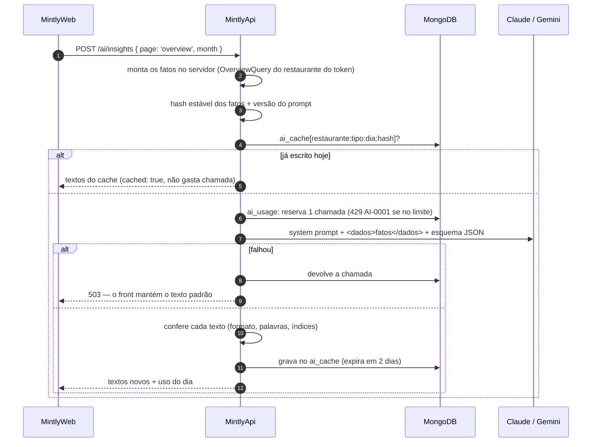

# 🤖 MintlyApi — IA do Mintly

A IA é um recurso do **plano Pro** com dois usos:

1. **Reescrever os textos dos cards de insight** da Visão Geral para o restaurante (`POST /ai/insights`).
2. **Sugerir o aumento de preço** de um prato do cardápio (`POST /ai/price-suggestion`).

Os números **nunca** vêm da IA: o relatório e o cardápio calculam tudo; a IA só escreve o texto (e, na sugestão de preço, propõe um valor que a API confere). Se a IA falhar, o app mostra o texto padrão.

Código: `src/app/ai/` · contratos e limites: `src/core/data/ai/ai-schema.ts` na [mintly-lib](../libs/mintly-lib.md).

> Relação com a visão de produto: estes dois usos são a primeira camada de IA. A visão maior (um agente que combina os dados internos do restaurante com preços externos coletados pelos [Workers](../workers/workers.md)) ainda não foi implementada.

---

## Acesso e limites

| Regra | Valor | Onde |
|---|---|---|
| Plano | só **Pro** (`requireProTier` → 403 `AI-0003`) | `require-pro-tier.ts` |
| Chamadas por restaurante por dia | **20** (`AI_DAILY_LIMIT`); o dia vira à meia-noite de São Paulo | `ai-repository.ts` |
| Palavras por card de insight | 35 (título + descrição); título até 10 | lib + `ai-prompts.ts` |
| Palavras na justificativa de preço | 45 | lib |
| Aumento máximo sugerido | **20%** sobre o preço atual | lib |

- Texto servido do **cache não gasta** chamada.
- **Falha da IA devolve a chamada** ao contador (`release`); resposta inaproveitável também não conta.
- O contador é um `findOneAndUpdate` com `upsert` e `count < limite` no filtro: duas chamadas simultâneas não passam do limite.

---

## Provedores

Escolhidos por `AI_PROVIDER` (mesmo padrão do `PAYMENT_PROVIDER`):

| Provedor | Variáveis | Detalhes |
|---|---|---|
| `claude` (padrão) | `ANTHROPIC_API_KEY` (obrigatória), `ANTHROPIC_BASE_URL`, `ANTHROPIC_MODEL` (padrão `claude-haiku-5-5`) | SDK oficial, sem streaming (respostas curtas); `effort: 'low'` e folga no `max_tokens`, porque o raciocínio do modelo conta no limite |
| `gemini` | `GEMINI_API_KEY` (obrigatória), `GEMINI_BASE_URL`, `GEMINI_MODEL` (padrão `gemini-3.5-flash-lite`), `GEMINI_THINKING_LEVEL` | chamada HTTP direta (`generateContent`), sem SDK; a chave vai no header `x-goog-api-key`, nunca na URL; uma nova tentativa em 429, erro de servidor ou rede |

- **Sem a chave** do provedor escolhido, as rotas respondem **503 `AI-0002`** sem gastar nada; o motivo vai para o log.
- As duas implementações seguem o contrato `TextGenerator` (`text-generator.ts`), o que permite trocar a IA por uma falsa nos testes.
- Resposta sempre em **JSON estruturado** pelo esquema (`INSIGHTS_SCHEMA`, `PRICE_SCHEMA`).

---

## Fluxo de uma chamada

---

## O que vai para a IA

O cliente **não envia dados**: só diz a tela e o mês (insights) ou o prato (preço). Os fatos são montados no servidor, a partir do restaurante do token.

| Uso | Fatos enviados |
|---|---|
| Insights | nome do restaurante, mês, e para cada insight do relatório: `index`, `kind` e os números/textos dele (valores, percentuais, datas, nomes de categoria) |
| Preço | prato (nome, grupo, preço, custo, margem, vendidos/mês, dias desde a última mudança e desde a última revisão de preço) e cardápio (nº de pratos ativos, margem média, nº de pratos e preço médio do mesmo grupo) |

Sem `menuItemId`, a sugestão de preço escolhe o prato ativo **há mais tempo sem mudar de preço**.

### Proteções

- **Prompt injection:** dados vindos de pessoas (nomes de prato, categoria) passam por `sanitizeFact` — sem quebras de linha, caracteres de controle ou `<`/`>`, e com tamanho máximo. Vão sempre num bloco `<dados>`, e o system prompt manda tratá-lo como informação, nunca como instrução.
- **Privacidade:** só os fatos acima são enviados. O log registra o tipo do erro, **nunca** o prompt (dados do restaurante) nem a chave.
- **Saída conferida** (`ai-text-rules.ts`): só texto simples numa linha, sem HTML, markdown, link ou emoji; símbolos normalizados (`42%`, aspas e travessões comuns). Card de insight acima do limite de palavras, com índice inválido ou repetido → descartado, e aquele card fica com o texto padrão. A justificativa de preço é cortada no limite (no último ponto final, se der). A tela mostra como texto puro, nunca como HTML.
- **Preço conferido:** o valor sugerido é sempre ajustado para ficar **entre o preço atual e +20%**. A justificativa não pode citar `%` nem `R$` (a tela mostra o número aplicado, e a frase não pode contradizê-lo); sem justificativa aproveitável, a sugestão vale com um texto de apoio padrão.

### Tom de voz

O system prompt (`AI_SYSTEM_PROMPT`) é único para todos os textos: português do Brasil, "você", frases curtas, sem jargão contábil ("custo dos ingredientes" em vez de "CMV"), sem emojis nem alarme, sempre citando o mês por extenso, usando **só** os números de `<dados>`, sem conselho jurídico ou tributário, e chamando o estabelecimento de "seu negócio" (pode ser bar, lanchonete…).

`AI_PROMPT_VERSION` entra na chave do cache: mudar o prompt invalida os textos já guardados no dia.

---

## Dados gravados

| Coleção | Conteúdo | Expira |
|---|---|---|
| `ai_usage` | `_id = restaurantId:dia`, `count` | 3 dias (TTL) |
| `ai_cache` | `_id = restaurantId:tipo:dia:hash`, `payload` (o texto validado) | 2 dias (TTL) |

Ver [Atributos das coleções](../base-de-dados/colecoes-atributos.md#ai_usage).

Ver também: [Relatórios e métricas](./relatorios-e-metricas.md) · [Assinatura e pagamentos](./assinatura-e-pagamentos.md) · [Erros](./erros.md).
