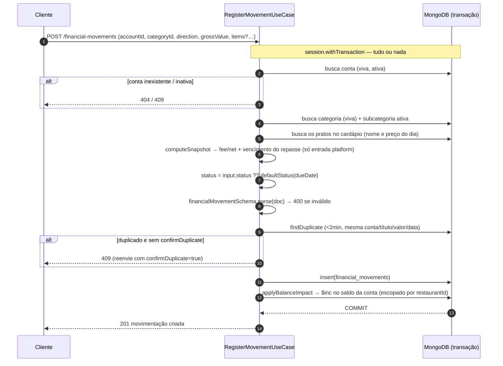
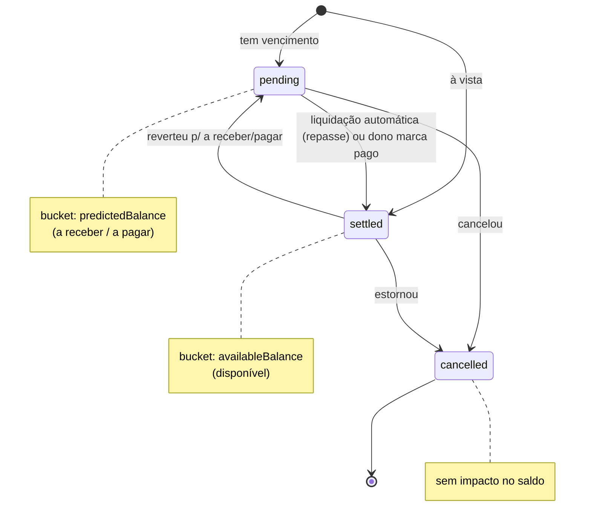

# 💸 MintlyApi — movimentações financeiras

O domínio mais complexo: cada movimentação (entrada/saída) é **transacional** e ajusta o saldo da conta no mesmo commit. Não usa o CRUD genérico — corpos e regras são dedicados. As regras puras ficam em `movement-rules.ts` (testáveis sem banco).

Ver também: [Modelo de dinheiro](./dinheiro.md) (buckets, `$inc`) · [Mapa de domínio](./mapa-de-dominio.md) · [Atributos de `financial_movements`](./colecoes-atributos.md#financial_movements).

---

## As três datas

| Campo | Quem preenche | Significado |
|---|---|---|
| `date` | o dono | dia do lançamento (venda, compra) |
| `dueDate` | o dono (boleto, fiado, cheque pré) **ou** o sistema (repasse de plataforma) | vencimento: o dia em que o dinheiro deve entrar ou sair. Vazio = à vista |
| `settledAt` | o sistema | quando o dinheiro de fato mexeu (à vista: `date`; liquidação automática: `dueDate`; dono no PATCH de status: agora ou a data informada) |

Quem lê a data de caixa usa `settledAt ?? dueDate ?? date` (`reports/shared/cash-date.ts`). Antes existia o `predictedReceiptDate`, só para entrada de plataforma; o `dueDate` o substituiu e passou a cobrir também contas a pagar.

---

## Registrar uma movimentação

Pontos-chave:

- **Snapshots (Extended Reference):** o doc guarda `account: { _id, name, type }`, `category: { _id, name, type }`, `subcategory: { _id, name }` e `items[]: { menuItemId, name, qty, unitPrice }` — congela tudo no momento do lançamento.
- **Pratos vendidos:** o cliente manda só `{ menuItemId, qty }` (até 30 pratos, 1–99 cada); nome e preço vêm do cardápio no servidor, para ninguém forjar o ranking de mais vendidos.
- **Taxa/líquido** só em **entrada de conta platform** (`computeSnapshot`); saída ou não-platform: `feeValue=0`, `netValue=grossValue`. A taxa e a regra de repasse aplicadas ficam congeladas em `feePercentApplied` + `settlementDaysApplied` (regra "N dias") ou `settlementRuleApplied` (semanal, quinzenal, mensal).
- **Vencimento do repasse:** a conta platform tem uma `settlementRule`. "N dias" soma N dias à `date` (0 = cai na hora, sem vencimento); semanal/quinzenal/mensal cai no **primeiro dia de repasse depois** do dia da venda (`settlementDueDate`, na mintly-lib).
- **Status default** (`defaultStatus`): **tem vencimento → `pending`; não tem → `settled`**. Uma regra só, para entrada e saída. Uma saída lançada hoje com vencimento de ontem nasce `pending` e aparece como vencida: vencer não é pagar.
- **Canal** (`dineIn`/`delivery`/`shared`) é opcional; sem ele os relatórios usam o canal efetivo (entrada em plataforma → delivery; outra entrada → dineIn; saída → shared).
- **Duplicidade:** bloqueia lançamento com mesma conta, título, valor bruto e data criado há menos de 2 min, salvo `confirmDuplicate=true`.
- **Saldo:** `applyBalanceImpact` faz `$inc` Decimal128 escopado por `restaurantId`; `matchedCount==0` → `NotFoundError` (sem drift silencioso).

---

## Ciclo de vida do status

O `status` decide o **bucket** do saldo. Toda transição **reverte** o efeito do status antigo e **aplica** o do novo, na transação.

Quem muda o status:

| Quem | Como | `statusSource` |
|---|---|---|
| sistema | registro, edição que cria/apaga o vencimento, liquidação automática | `auto` |
| dono | `PATCH /:id/status` (pode informar a data em que pagou/recebeu) | `manual` — **trava permanente**: o robô nunca mais mexe nesse movimento |

Documentos anteriores ao campo (sem `statusSource`) são lidos como `auto`.

---

## Liquidação automática (`settle.yml` → `npm run db:settle`)

Todo dia às 06:00 UTC um workflow do GitHub Actions roda o `SettleDueMovementsUseCase` por ambiente. Ele liquida o que está `pending` com `dueDate` vencido, **desde que**:

- seja **entrada em conta `platform`** — é o único dinheiro que cai sozinho. Boleto vencido **não** foi pago, e entrada a prazo em conta comum (fiado, cheque pré) depende de o cliente pagar; liquidar esses esvaziaria o bloco "Vencidos" do Fluxo de Caixa.
- `statusSource` não seja `manual`.

Detalhes de projeto:
- **Cross-tenant de propósito:** uma query por ambiente pega os movimentos de todos os restaurantes (o `restaurantId` é campo, não banco). As escritas continuam escopadas pelo `restaurantId` do próprio documento.
- **Uma transação por movimento:** um documento problemático não derruba a rodada nem prende o banco.
- **Idempotente:** rodar duas vezes não duplica saldo. `settledAt` = o `dueDate` (o repasse caiu na data, mesmo que o robô rode depois).
- **Script, não rota HTTP:** evita um segundo mecanismo de autenticação para robô. Cada ambiente é liquidado pelo código da branch que o deploya (staging ← `staging`, production ← `main`).

---

## Editar e reconciliar

- **`PATCH /:id` (update):** reconstrói o doc e corrige o saldo — **reverte o efeito antigo na conta antiga** e **aplica o novo na conta nova**. `direction` é imutável.
  - **Não reprecifica:** a taxa e a regra de repasse vêm do snapshot congelado no lançamento, então editar o título não muda o líquido. Só ao **trocar de conta** a taxa é recalculada pela conta nova.
  - **Vencimento** (`resolveDueDate`): o informado agora > o calculado pela conta com prazo > o já gravado, se tiver sido informado pelo dono. Mover um boleto entre contas bancárias preserva o vencimento; tirar um recebível de uma conta platform apaga o vencimento derivado dela.
  - **Status acompanha o vencimento** (`shouldRecomputeStatus`) só quando ele passa a existir ou deixa de existir, nunca quando só muda de data — corrigir a data de um boleto não pago não o marca como pago. Não recalcula se o status é `manual`, `cancelled` ou foi mudado explicitamente na mesma edição.
- **`POST /recompute-balances`:** reconcilia o saldo de uma conta a partir das movimentações (recalcula os dois buckets).

---

## Importação de planilha (`POST /import`)

`ImportMovementsUseCase` recebe até **500 linhas** no mesmo formato do `POST /` (+ `row`, o número da linha) e uma `idempotencyKey`.

- **Tudo ou nada:** todas as linhas seguem as mesmas regras do registro numa **única transação**, em lote (`executeBatch`): conta, categoria e pratos lidos uma vez, duplicidade numa consulta, um `insertMany` e um `$inc` por conta. Se qualquer linha falhar, nada é gravado; o resultado traz o motivo de cada linha com problema (as demais voltam como `ROLLED_BACK`), para corrigir tudo de uma vez.
- **Idempotência** (`movement_imports`): a chave é reservada antes de gravar. Reenviar a chave de uma importação concluída devolve o resultado guardado (`replayed: true`); duas importações iguais ao mesmo tempo → a segunda recebe 409. Importação desfeita libera a chave. A chave expira em 30 dias.
